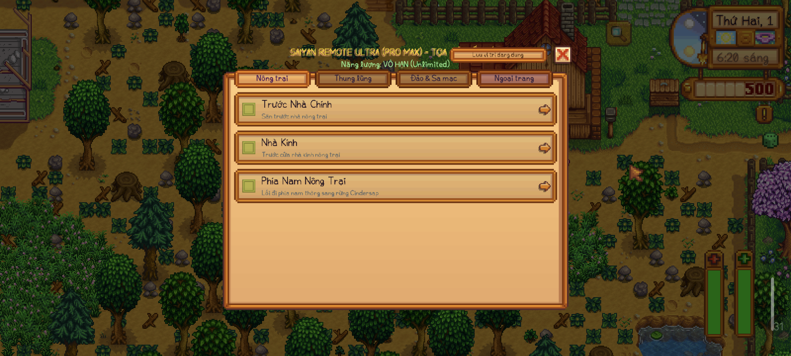
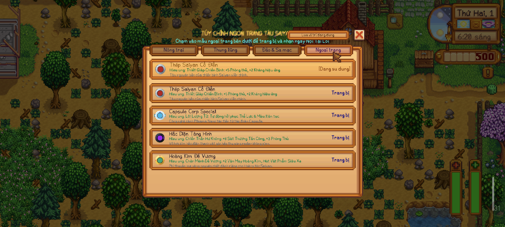
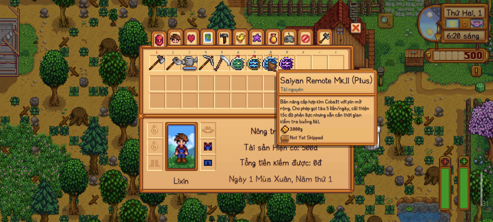

# Saiyan Pod Teleport (v1.0.0)

**Tác giả:** dinhmaiphuong2025  
**Yêu cầu:** Stardew Valley 1.6+ | SMAPI 4.0+  
**Nền tảng hỗ trợ:** Android (Cinderbox / SMAPI Android) & PC (Windows / Linux / macOS)  

---

## 1. Giới Thiệu (Overview)

**Saiyan Pod Teleport** mang công nghệ du hành không gian từ Capsule Corp vào thung lũng Stardew Valley! Thay vì dịch chuyển tức thời nhàm chán, mod mang đến trải nghiệm **hoạt cảnh điện ảnh đỉnh cao**:
- Tàu Saiyan lao từ quỹ đạo xuống mặt đất với vệt lửa phản lực bốc cháy.
- Va chạm mặt đất tạo làn khói bụi rung chuyển màn hình.
- Nắp buồng lái tự động nâng lên, nhân vật bước vào trong.
- Động cơ kích hoạt đẩy con tàu vút thẳng lên không trung, xé rách tầng khí quyển trước khi đáp xuống điểm đến.

Mod được tối ưu đặc biệt cho **màn hình cảm ứng điện thoại (Android Cinderbox)**: giao diện chia tab ngang, nút bấm lớn, không che khuất thanh công cụ, cơ chế chống chạm nhầm khi cuộn vuốt.

---

## 📸 Hình Ảnh Trực Quan Trong Game (Screenshots)

| Giao diện chọn điểm đến (Tab Nông Trại) | Tùy chỉnh Ngoại trang & Buff tàu (Tab Ngoại Trang) |
| :---: | :---: |
|  |  |

| Balo người chơi với 4 cấp độ Saiyan Remote |
| :---: |
|  |

---

## 2. Bốn Cấp Độ Điều Khiển (Remote Tiers)

> 💡 **LƯU Ý VỀ CÁCH SỞ HỮU THIẾT BỊ:**  
> - **Khi cài độc lập (Mod thuần túy):** Thiết bị Remote được **tự động cấp MIỄN PHÍ** vào túi đồ ngay khi bạn vào game (tùy theo file zip bạn tải hoặc cấu hình trong `config.json`). Bạn **không cần bỏ tiền mua** và không cần NPC hay cửa hàng nào.
> - **Cột "Giá Mua Tại Shop" chỉ áp dụng:** Khi và chỉ khi bạn cài đặt thêm mod addon **`[CP] Chrono Merchant`** và muốn trải nghiệm kiếm tiền để mua từ Thương nhân du mục trong Rừng Cindersap!

| Cấp Độ | Tên Thiết Bị | Giới Hạn/Ngày | Tốc Độ Rơi/Bay | Thời Gian Ra/Vào | Vượt Rào Cản Khu Vực | Cách Nhận Mặc Định | Giá Mua (Nếu Cài ChronoMerchant) |
| :--- | :--- | :---: | :---: | :---: | :---: | :---: | :---: |
| **Mk.I (Base)** | Saiyan Remote Mk.I | 2 lần/ngày | Đầm chắc (6.5 / 6.0) | 2.2s / 2.0s | Không (chỉ khu vực đã mở) | Tự nhận trong balo (Free) | 2,500g (Casual) / 5,000g (Balanced) |
| **Mk.II (Plus)** | Saiyan Remote Mk.II | 5 lần/ngày | Nhanh +60% (10.5 / 9.5) | 1.6s / 1.5s | Không | Tự nhận trong balo (Free) | 10,000g (Casual) / 15,000g (Balanced) |
| **Mk.III (Pro)** | Saiyan Remote Mk.III | 10 lần/ngày | Tốc độ cao (15.5 / 14.0) | 1.1s / 1.0s | Không | Tự nhận trong balo (Free) | 25,000g (Casual) / 40,000g (Balanced) |
| **Ultra (Pro Max)** | Saiyan Remote Ultra | **Vô hạn** | Siêu thanh (24.0 / 22.0) | 0.65s / 0.55s | **Có (Vượt mọi rào cản)** | Tự nhận trong balo (Free) | 50,000g (Casual) / 100,000g (Balanced) |

*Ghi chú:* Khi sở hữu nhiều remote trong túi, mod sẽ tự động kích hoạt hiệu ứng của bản cấp cao nhất bạn đang mang.

---

## 3. Danh Sách Địa Điểm Dịch Chuyển (Destinations)

Hệ thống điều khiển được phân chia thành **3 Tab địa điểm** tiện lợi:

### 🌾 Tab 1: Nông Trại (Farm)
1. **Trước Nhà Chính:** Sân trước hiên nhà nông trại.
2. **Nhà Kính:** Trước cửa nhà kính (Yêu cầu đã sửa nhà kính hoặc dùng Remote Ultra).
3. **Phía Nam Nông Trại:** Lối đi phía nam thông sang rừng Cindersap.

### 🏘️ Tab 2: Thung Lũng Pelican (Valley)
4. **Quảng Trường Pelican:** Trung tâm thị trấn.
5. **Tiệm Tạp Hóa Pierre:** Cửa hàng hạt giống của Pierre.
6. **Bãi Biển & Cửa Hàng Willy:** Bãi cát trước cửa tiệm cá của Willy.
7. **Xưởng Mộc Robin:** Sân trước xưởng mộc trên núi.
8. **Hiệp Hội Mạo Hiểm & Hang Mỏ:** Khu vực cửa hang mỏ phía đông bắc núi.
9. **Trang Trại Marnie:** Sân cỏ rộng trước nhà trang trại gia súc của Marnie.
10. **Tháp Pháp Sư:** Góc tây nam rừng Cindersap.
11. **Rừng Bí Mật (Secret Woods):** Gần ao cá và tượng cụ Cannoli (Yêu cầu rìu thép hoặc dùng Remote Ultra).
12. **Khu Xe Lửa & Suối Nước Nóng (Railroad):** Sân trước nhà tắm khoáng nóng Bathhouse (Mở sau động đất hè năm 1).
13. **Trạm Xe Buýt (Bus Stop):** Cạnh chiếc xe buýt và lối vào trang trại.

### 🌴 Tab 3: Đảo & Sa Mạc (Islands & Desert)
14. **Sa Mạc Calico:** Khu đất sa mạc cạnh ốc đảo Oasis (Yêu cầu xe buýt đã sửa hoặc dùng Remote Ultra).
15. **Bến Tàu Đảo Ginger (Island South):** Bãi cát bến tàu phía nam đảo Ginger (Yêu cầu tàu Willy đã sửa hoặc dùng Remote Ultra).
16. **Nông Trại Đảo Ginger (Island West):** Trước hiên nhà nông trại nghỉ dưỡng trên đảo Ginger.
17. **Miệng Núi Lửa & Hang Động (Island North):** Lối vào hầm ngục núi lửa đảo Ginger.
18. **Nhà Trên Cây Của Leo (Island East):** Khu rừng nhiệt đới phía đông đảo Ginger.

> ⚠️ **LƯU Ý TƯƠNG THÍCH BẢN ĐỒ:**  
> - Mod hiện tại **chỉ hỗ trợ toàn diện các bản đồ gốc của game (Vanilla Stardew Valley 1.6+)**.  
> - **CHƯA HỖ TRỢ** các địa điểm dịch chuyển thuộc các bản mod mở rộng bản đồ như **Stardew Valley Expanded (SVE)**, **Ridgeside Village (RV)**, **East Scarp**... (Các địa điểm riêng của SVE / RV chưa được tích hợp tọa độ đáp tàu trong phiên bản v1.0.0 này).

---

## 4. Hệ Thống Skin Buồng Lái & Lửa Phản Lực

Tàu Saiyan hỗ trợ 4 bộ ngoại trang độc quyền với hoạt ảnh ngọn lửa phản lực riêng biệt:
1. **Classic White:** Vỏ trắng viền xanh nguyên bản của người Saiyan, lửa cam truyền thống.
2. **Capsule Blue:** Hợp kim Capsule Corp xanh lam bóng bẩy, lửa phản lực Cyan tương lai.
3. **Golden Emperor:** Mạ vàng hoàng gia bóng loáng, lửa Plasma vàng kim rực rỡ.
4. **Obsidian Shadow:** Hợp kim bóng đêm tàng hình, lửa tím bóng tối huyền bí.

*Cách đổi skin:* Mở menu điều khiển -> chuyển sang tab **"Ngoại trang"** -> chạm vào mẫu tàu bạn muốn áp dụng.

---

## 5. Ghim Tọa Độ Tiếp Đất Tùy Ý (Custom Landing Tiles)

Người chơi có thể tự do ghim tọa độ hạ cánh chính xác cho từng bản đồ (ví dụ: ngay trước cửa chuồng bò, cạnh hòm thư, hoặc trước lều câu cá):
- Trong menu chọn điểm đến, mỗi địa điểm có nút **"Ghim Tọa Độ Hiện Tại"**.
- Khi đứng ở bất kỳ ô đất mong muốn, bấm nút Ghim, lần sau tàu sẽ đáp chính xác ngay ô đất đó!

---

## 6. Hướng Dẫn Cài Đặt (Installation)

1. Cài đặt **SMAPI** bản mới nhất (4.0+).
2. Tải bản `.zip` tương ứng với nhu cầu của bạn (xem mục 8).
3. Giải nén thư mục `SaiyanPodTeleport` vào thư mục `Mods`:
   - **PC:** `Stardew Valley/Mods/`
   - **Android (Cinderbox):** `/storage/emulated/0/StardewValley/desktop/Mods/`
4. Khởi động game thông qua SMAPI.

---

## 7. Cấu Hình (config.json)

Sau lần chạy đầu tiên, file `config.json` sẽ được tạo:
```json
{
  "AutoGrantItemOnLoad": true,
  "GrantedRemoteTier": "Base",
  "ScreenShakeEnabled": true,
  "CurrentSkin": "default",
  "CustomLandingTiles": {}
}
```
- `AutoGrantItemOnLoad`: `true` để tự động nhận remote vào túi đồ khi tải save; `false` nếu muốn tự kiếm tiền mua từ thương nhân.
- `GrantedRemoteTier`: Chọn cấp độ tự cấp (`"Base"`, `"Plus"`, `"Pro"`, `"ProMax"`, `"All"`, `"None"`).

---

## 8. Các Gói Phát Hành (Release Packages)

- **SaiyanPodTeleport_v1.0.0_Base.zip** — Mặc định cấp bản Mk.I (Base).
- **SaiyanPodTeleport_v1.0.0_Plus.zip** — Mặc định cấp bản Mk.II (Plus).
- **SaiyanPodTeleport_v1.0.0_Pro.zip** — Mặc định cấp bản Mk.III (Pro).
- **SaiyanPodTeleport_v1.0.0_ProMax.zip** — Mặc định cấp bản Ultra (Pro Max).
- **SaiyanPodTeleport_v1.0.0_AllInOne.zip** — Cấp đủ cả 4 bản remote để thử nghiệm.

*Tùy chọn bổ sung:* Cài đặt thêm mod addon **`[CP] Chrono Merchant`** nếu bạn muốn gặp Thương Nhân Thời Không bán các dòng remote này trong rừng!
